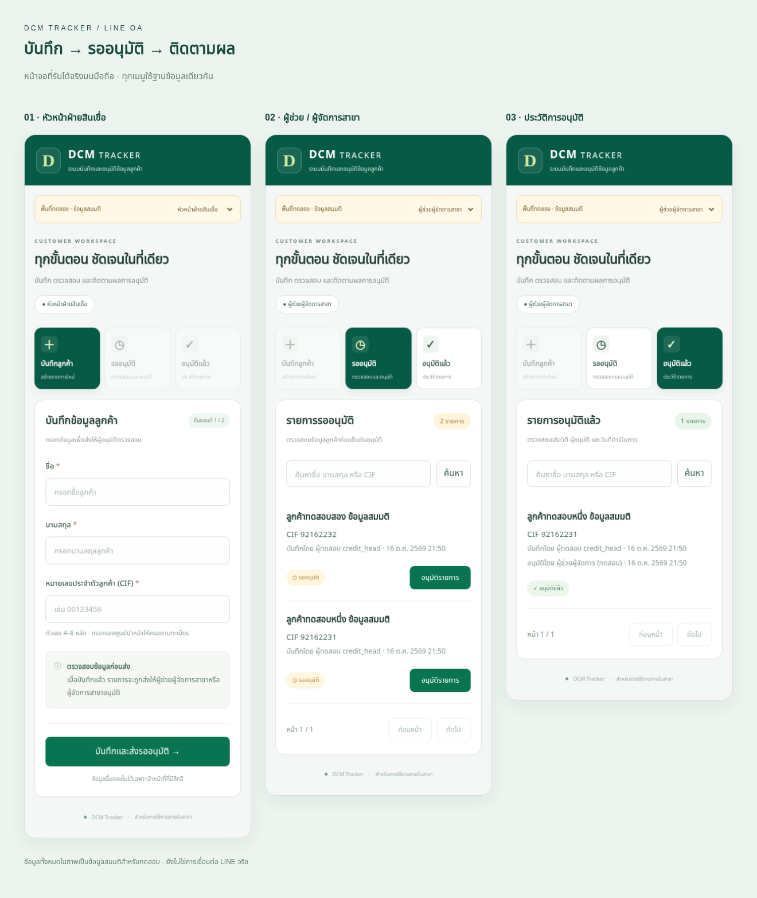

# DCM Tracker — ระบบใหม่สำหรับ LINE Official Account

ระบบเดียว: **LINE LIFF → Cloudflare Worker → Cloudflare D1** หน้าฟอร์มและรายการอนุมัติใช้ฐานข้อมูลเดียวกัน ไม่ต้องใช้ Google Apps Script หรือ Google Sheets ในระบบใหม่นี้ ข้อมูลของระบบเก่ายังไม่ได้ย้ายมา และงานเดิมเก็บใน `legacy/`



## สิ่งที่ทำได้

| ผู้ใช้ | การใช้งาน |
|---|---|
| หัวหน้าฝ่ายสินเชื่อ / หัวหน้าหน่วย | บันทึกชื่อ นามสกุล และ CIF ส่งรออนุมัติ |
| ผู้ช่วยผู้จัดการสาขา | ดูรายการรออนุมัติ กดอนุมัติ และดูประวัติ |
| ผู้จัดการสาขา | ดูรายการรออนุมัติ กดอนุมัติ และดูประวัติ |
| ผู้ดูแลระบบ | กำหนดตำแหน่ง เปิดสิทธิ์ หรือระงับเจ้าหน้าที่ |

ผู้อนุมัติคนใดคนหนึ่งอนุมัติได้ ไม่ต้องอนุมัติสองทอด ระบบบันทึกผู้ทำรายการ เวลา และ audit log ป้องกันอนุมัติซ้ำและ CIF ซ้ำในรายการรออนุมัติ CIF เก็บเป็นข้อความจึงรักษาศูนย์นำหน้า รุ่นแรกยึด 4–8 หลักตามฟอร์มเดิม เปลี่ยนข้อกำหนดได้ภายหลัง

Rich Menu มี 3 ช่อง: บันทึกลูกค้า / รออนุมัติ / อนุมัติแล้ว แต่ละช่องเปิดหน้า LIFF ที่ตรงกัน เซิร์ฟเวอร์ตรวจสิทธิ์ทุกคำขอ ผู้ที่ยังไม่ได้รับสิทธิ์เห็นเฉพาะหน้ารอรับสิทธิ์พร้อมรหัสบัญชีของตน

## ทดลองในสภาพแวดล้อมพัฒนา

ผู้ดูแลสามารถทดลองออนไลน์ได้ทันที: เปิดระบบผ่าน LINE → หน้า “กำหนดสิทธิ์เจ้าหน้าที่” → **เปิดพื้นที่ทดลอง** พื้นที่นี้อยู่ที่ `/sandbox` ต้องเข้าสู่ LINE ด้วยบัญชีผู้ดูแลก่อนสลับบทบาทได้ ใช้ D1 binding `SANDBOX_DB` แยกจากฐานลูกค้าจริง `DB` และมีข้อมูลสมมติเริ่มต้น 15 รายการ (รออนุมัติ 10 / อนุมัติแล้ว 5) การลองอนุมัติจะเปลี่ยนสถานะเฉพาะข้อมูลสมมติ ไม่ต้องให้เจ้าหน้าที่คนอื่นแอด LINE

ในพื้นที่ทดลองกด **ลอง Rich Menu** เพื่อทดลองภาพเมนู 3 ช่องแบบกดได้ เลือกบทบาทก่อนคลิกเพื่อดูการเปิดหน้าและการตรวจสิทธิ์ โดยไม่ต้องมี Messaging API token

โหมดนี้ไม่ใช่การปลดสิทธิ์ของหน้าเว็บจริง ผู้ใช้ทั่วไปแม้ส่ง header เลือกบทบาทมาจะเข้าข้อมูลทดลองไม่ได้ และเส้นทางระบบจริงยังคงตรวจตำแหน่งตามบัญชีเดิม

ต้องใช้ Node.js 24+ ไม่มีแพ็กเกจ runtime เพิ่มเติม:

```bash
npm test
npm run build
npm run dev
```

เติมข้อมูลตัวอย่างสำหรับฐานทดลองในเครื่องด้วย `npm run demo:seed` การรันซ้ำไม่ล้างข้อมูลหรือย้อนสถานะที่ลองอนุมัติไปแล้ว ผู้ที่ deploy ต้องใช้ `npm run demo:seed -- --remote` หลัง `npm run deploy` เพื่อเติมข้อมูลในฐานทดลอง Cloudflare สคริปต์จะตรวจว่า SANDBOX_DB กับ DB เป็นคนละฐานก่อนเสมอ

โปรแกรมทดลองฟังเฉพาะ loopback port 3000 ใช้ `PORT=3100 npm run dev` เพื่อเปลี่ยน port ฐานข้อมูลทดลองคือ `data/v2.sqlite` การเลือกบทบาททดลองทำงานเฉพาะ local simulator และถูกปิดบน hostname สาธารณะ ห้ามใช้ข้อมูลลูกค้าจริงในตัวทดลอง

การทดสอบ API ใช้ SQL และ handler ชุดเดียวกับ Worker โดยมี SQLite adapter สำหรับ Node การทดสอบ LINE และ Cloudflare API ใช้ข้อมูลจำลอง ไม่ใช่การยืนยันบัญชีหรือ deploy จริง มี browser smoke test ที่ `tools/browser-smoke.py` (ต้องมี Python Playwright และ Chromium) ซึ่งกรอกข้อมูล กดอนุมัติ ตรวจข้อมูลหลัง reload และสร้างภาพหน้าจอ

ผลทดสอบพื้นที่ทดลองเพิ่มเติม: [รายงาน](docs/SIMULATION.md) และ `tools/sandbox-smoke.py` (รัน simulator port 3210 พร้อมฐานทดลองที่เติมข้อมูลแล้ว)

## เชื่อมบัญชีและเปิดใช้จริง

ดู [คู่มือเปิดใช้งานสำหรับผู้ดูแล](docs/SETUP.md) ก่อน โปรแกรมมีสคริปต์สร้าง D1, deploy Worker, ตรวจ health และตั้ง Rich Menu แล้ว แต่ต้องมีสิทธิ์บัญชีจริงก่อนเรียกใช้

```bash
npm run deploy
npm run line:menu
# เปิดเมนูให้ทุกคนเมื่อระบบและ LIFF พร้อมแล้ว:
npm run line:menu -- --publish
```

ค่าเริ่มต้น deploy เป็น Worker ใหม่ `baac-dcm-tracker-v2` เพื่อรักษา `baac-dcm-form` เดิม ไม่ลบ Worker, Rich Menu หรือฐานข้อมูลเก่า สคริปต์ปฏิเสธการเขียนทับ Worker ที่ไม่มี tag ของโปรเจกต์นี้ และไม่มีการล้างฐานข้อมูลอัตโนมัติ

GitHub Actions ตรวจ tests และ build เมื่อ push main หากตั้ง Cloudflare credential แล้วจะ deploy ตามไปด้วย **การตั้งค่า cloud environment/Publish ใน Codex เป็นการเก็บสภาพแวดล้อมพัฒนา ไม่ใช่การ deploy เว็บสู่ Cloudflare**

## ขอบเขตรุ่นแรก

ใช้สำหรับสาขาเดียว ไม่เก็บเลขสัญญา/วงเงิน ไม่รองรับการแก้ไข ปฏิเสธ ส่งต่อชุดสัญญา หรือค้นเอกสารแบบระบบเก่า ผู้ดูแลจัดการสิทธิ์ผ่านหน้าเว็บได้ รายการลูกค้ามีค้นหาและแบ่งหน้า 20 รายการ ต้องกำหนดนโยบายสำรอง/เก็บรักษาข้อมูลและตรวจบัญชีจริงครบแต่ละตำแหน่งก่อนใช้กับข้อมูลจริง
